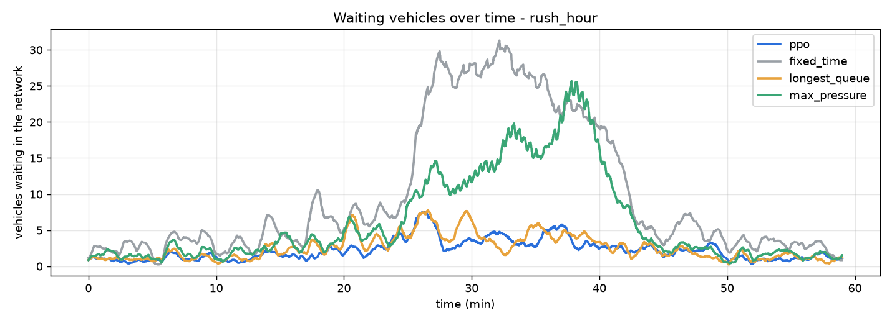

# Smart Traffic Lights with Reinforcement Learning (PPO)

**Projet 5 – Optimisation d'un réseau de transport intelligent**
Module *Renforcement Learning et Optimisation* – Cycle Ingénieur en Informatique, 5ème année DS.

The project trains an agent that controls traffic lights to reduce congestion. It works on a single
intersection and on a network of connected intersections. The agent uses **Proximal Policy
Optimization (PPO)** with **epsilon-greedy exploration** early in training. It runs on a custom
traffic simulator written in Python, so you don't need to install SUMO.



## Key results

Mean waiting time per vehicle, in seconds (averaged over 5 seeds × 1 hour of simulated traffic, lower is better):

| Scenario | Fixed-time | Longest-queue | Max-pressure | **PPO (ours)** | PPO vs fixed-time |
|---|---|---|---|---|---|
| **Single intersection** |
| normal | 10.82 | 5.79 | 6.65 | **5.38** | −50 % |
| unbalanced | 25.35 | 5.28 | 10.61 | **4.23** | −83 % |
| rush hour | 21.06 | 5.54 | 13.36 | **4.92** | −77 % |
| accident | 35.26 | **17.42** | 18.28 | 19.39 | −45 % |
| event *(never seen in training)* | 28.62 | 6.43 | 13.49 | **5.04** | −82 % |
| **2×2 network (4 intersections)** |
| normal | 18.71 | 11.50 | 12.80 | **10.10** | −46 % |
| rush hour | 32.60 | 12.14 | 18.98 | **10.09** | −69 % |
| accident | 33.01 | 19.83 | 22.33 | **17.13** | −48 % |
| event *(never seen in training)* | 35.91 | 12.18 | 20.49 | **10.05** | −72 % |

PPO also cuts CO₂ emissions by 15–68 % compared with fixed-time plans, because vehicles stop less often.
Full tables are in [`results/single/eval_summary.md`](results/single/eval_summary.md) and
[`results/grid2x2/eval_summary.md`](results/grid2x2/eval_summary.md).

## Project structure

```
traffic_rl/
  envs/
    simulator.py     # cellular-automaton traffic simulator (grid of intersections)
    scenarios.py     # demand profiles: low, normal, unbalanced, rush_hour, accident, event
    traffic_env.py   # RL environment (multi-agent) + Gymnasium wrapper
  agents/
    ppo.py           # PPO from scratch (PyTorch): actor-critic, GAE, clipping, epsilon-greedy
    baselines.py     # fixed-time, longest-queue (actuated), max-pressure, random
  training.py        # rollout collection, training loop, evaluation
  utils/plotting.py  # figures
scripts/
  train.py           # train an agent
  evaluate.py        # compare PPO with the baselines on all scenarios
  tune.py            # random-search hyper-parameter optimisation
tests/               # unit tests (pytest)
results/             # trained models, logs, tables and figures
docs/
  PROJECT_EXPLAINED.md    # detailed explanation of the whole project
  PRESENTATION_PROMPT.md  # prompt to generate the presentation slides
```

## Quick start

```bash
python -m venv .venv
# Windows: .venv\Scripts\activate   |   Linux/macOS: source .venv/bin/activate
pip install -r requirements.txt

# Train (single intersection, ~5 min on CPU)
python scripts/train.py --episodes 600 --out results/single

# Train on a 2x2 network of intersections (~12 min on CPU)
python scripts/train.py --rows 2 --cols 2 --episodes 400 --out results/grid2x2

# Evaluate against the baselines (tables + figures)
python scripts/evaluate.py --model results/single/ppo_best.pt --out results/single
python scripts/evaluate.py --model results/grid2x2/ppo_best.pt --rows 2 --cols 2 --out results/grid2x2 --no-random

# Hyper-parameter search
python scripts/tune.py --trials 12 --episodes 150

# Tests
python -m pytest -q
```

Useful options: `--co2-coef 0.001` adds a CO₂ penalty to the reward (ecological variant),
`--scenarios rush_hour accident` restricts the training scenarios, and `--eps-start` sets the initial epsilon.

## RL formulation (summary)

| Element | Definition |
|---|---|
| **State** | For each of the 4 incoming lanes: number of waiting vehicles, mean waiting time, and occupancy of the 10 cells closest to the stop line (where the vehicles are). Also: occupancy of the 4 downstream lanes, the current phase (one-hot), and the time since the green started. 55 features. |
| **Action** | 12 discrete actions = (which phase gets the green: N-S or E-W) × (green duration ∈ {5, 10, 15, 20, 25, 30} s). Switching phase inserts a 3 s yellow. |
| **Reward** | `−0.01 × (vehicle-seconds of waiting)` + `0.1 × (queue before − queue after)` (+ optional CO₂ penalty) |
| **Algorithm** | PPO-Clip, GAE(λ = 0.95), γ = 0.98, 2×128 tanh MLP, epsilon-greedy from 0.3 → 0 over the first 30 % of training, parameter sharing between intersections |

See [`docs/PROJECT_EXPLAINED.md`](docs/PROJECT_EXPLAINED.md) for the full explanation.
